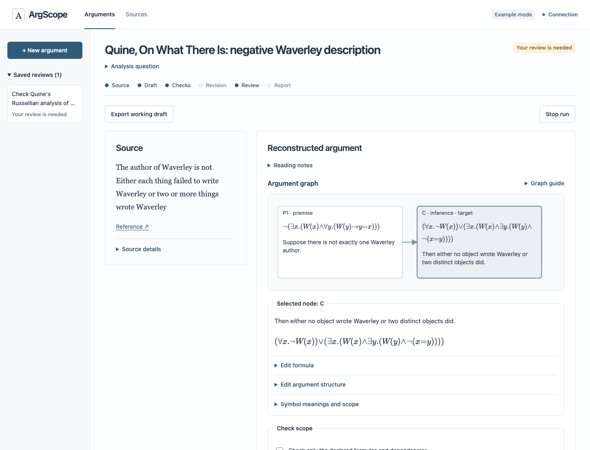
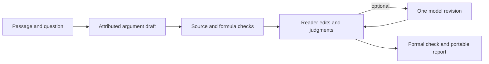

# ArgScope Research Workbench

ArgScope turns philosophical passages into editable argument graphs. An LLM
proposes premises, conclusions and reasoning steps; readers can inspect source
quotations, revise the interpretation, and check formalized inferences with
DPLL and Z3.

Returned countermodels are checked against the original formulas. Version history
lets readers compare alternative reconstructions, preserve edits and judgments,
and resume a review across application restarts.

The application includes a React graph editor, resumable LangGraph workflows,
a source library, and a custom RESP/TCP key-value service for tool requests and
results. SQLite retains argument versions, review records and workflow checkpoints.

## See the workflow

A review starts with one passage and a question. The browser generates one draft,
shows its graph and candidate checks, and pauses for the reader. The reader can
edit formulas and joint premises, add an explicit assumption, request one revision,
compare saved versions, and export the resulting review.

### Example: Quine's Waverley description



The example examines whether denying a unique author means no author, or also
permits multiple authors. The source passage stays on the left; the argument
graph and typeset formulas are on the right. Select a graph node to read its
complete formula. Open “Edit formula” or “Edit argument structure” to change the
saved text notation and joint dependencies.

New reviews open with empty source and question fields. This optional offline
example supplies an authored reconstruction and uses the application's normal
editing, storage and logic-checking workflow. See the
[offline instructions](#run-an-offline-example) to load it, or view the
[blank starting screen](workbench/docs/assets/start.png).



The interface separates source attribution, interpretation and formal results.
Readers confirm the mapping from a passage to formulas; exported reports retain
the formulas and assumptions behind each check.

## Run an offline example

Use Python 3.10 or 3.11 on macOS or Linux. From the project root:

```bash
python3.10 -m venv .venv
.venv/bin/python -m pip install -r workbench/requirements-review.txt
export PYTHONPATH="$PWD/workbench:$PWD/argscope:$PWD/falsifylab:$PWD/sourcelens"

.venv/bin/python -m workbench.review_app \
  --provider papers --kv-root vendor/kv_server \
  --data-dir workbench/outputs/paper-examples-data \
  --port 8767 --open-browser
```

Open “Try an example,” select Quine's negative-description example or Chalmers's
displayed intelligence-explosion argument, then choose “Use example” and
“Run demo review.” Inspect the reconstruction and record a review.
The service starts an isolated copy of the bundled KV and retains its AOF under
the selected application data directory. Stop it with Control+C.

The portable package contains both built interfaces. For a source checkout, build
them with Node 22 before starting:

```bash
npm ci --prefix sourcelens/web
npm run build --prefix sourcelens/web
node sourcelens/web/node_modules/vite/bin/vite.js build \
  --config workbench/review_web/vite.config.mjs
```

[Setup and use](workbench/docs/MVP_GUIDE.md) covers live providers, native macOS
launchers, backups, AOF maintenance and troubleshooting. Model access is optional
for the offline examples and required for new model-generated reconstructions.

## What is implemented

- Source-linked nodes distinguish author, opponent, hypothetical claims and added
  assumptions. Strict validation checks quotes, graph references and formula syntax.
- The graph editor changes formulas, joint incoming dependencies and the target.
  Advanced JSON editing handles complete reconstruction changes.
- Tseitin encoding and DPLL check propositional inferences. A separate first-order
  parser and Z3 adapter support closed quantified formulas and equality.
- Returned countermodels are evaluated again on the original formula ASTs.
  Failed or unresolved intermediate steps block their dependents.
- Review judgments bind to the exact edited draft. Changes hide stale previews
  and require new mapping/scope confirmations.
- One requested model revision, immutable saved versions, field comparison,
  process-restart recovery, and JSON/HTML export form one workflow.

Symbol meanings are recorded in the mapping explanation alongside the formulas.
Readers can edit both when comparing interpretations.

## Architecture and technical choices

| Choice | Reason and tradeoff |
| --- | --- |
| Prose records before formulas | Preserve speaker, evidence and assumptions while a reading is still being interpreted. Structure validation cannot decide whether an interpretation is faithful. |
| One checkpoint authority | LangGraph owns execution position; a separate archive owns content and receipts. Restart does not reconstruct a competing cursor from display events. |
| Content-bound review | Draft hashes, expected-version checks and preview freshness prevent an old approval or calculation from surviving an edit. |
| Separate logic backends | DPLL suits propositional structure; quantified uniqueness requires first-order semantics. Finite witnesses receive an independent AST check; UNSAT evidence still trusts Z3. |
| Durable SQLite plus expiring KV | SQLite retains reviews across restarts. KV transfers immutable inputs and results to supervised child tools; expiring a transport entry leaves the durable review intact. |
| Bounded sequential model roles | One generation is enough to begin reader review. Optional critique/revision reuses one configured provider, with explicit attempt limits and no automatic provider fallback. |

The [engineering design](workbench/docs/ENGINEERING_DESIGN.md) explains the
algorithms, state owners, interfaces, crash windows and alternatives, with links
to implementation and tests.

## Results and reproducibility

The four component suites passed 233 regression tests on 26 November 2026.
Extracted-package acceptance exercised both interfaces, real KV/child execution,
feedback and saved versions, process restart, and four exported-report replays.
These checks used offline providers and simulated reviewers.

Six formal controls cover valid and deliberately altered Quine/Chalmers mappings.
For Quine, replacing “not exactly one author” with “no author” yields a verified
two-object countermodel. The [logic guide](workbench/docs/FIRST_ORDER_GUIDE.md)
gives the formulas and reproducible command.

A separate four-passage pilot completed 20 live Codex calls and twelve paired
drafts. It exposed attribution and qualification issues; independent semantic
scores and reader-effort measurements remain pending. The
[technical report](workbench/docs/FINAL_REPORT.md) separates those observations
from software acceptance and explains the experiment design.

```bash
.venv/bin/python -m pip install pytest==7.1.2
export REVIEW_TEST_KV_ROOT="$PWD/vendor/kv_server"
.venv/bin/python -m pytest -q argscope/tests
.venv/bin/python -m pytest -q falsifylab/tests
.venv/bin/python -m pytest -q sourcelens/tests
.venv/bin/python -m pytest -q workbench/tests
.venv/bin/python workbench/tools/check_reference_cases.py
```

The [CI workflow](.github/workflows/tests.yml) builds both interfaces and exercises
an extracted package on Ubuntu and macOS without model credentials.

## Source layout

| Path | Responsibility |
| --- | --- |
| `workbench/workbench/review/` | Reconstruction contracts, workflow, storage, providers, tools and export |
| `workbench/workbench/review_app.py` | FastAPI composition and application lifecycle |
| `workbench/review_web/` | React editor, HTTP client and version comparison |
| `argscope/` | Propositional parser, formula AST, dependencies and DPLL |
| `falsifylab/` | Witness validation, numerical tools and KV adapters |
| `sourcelens/` | Versioned source library and retrieval interface |
| `vendor/kv_server/` | Pinned RESP/TCP, TTL and AOF runtime |
| `workbench/tests/`, `workbench/tools/` | Regression, browser acceptance and experiment tools |

## Documentation

- [Engineering design](workbench/docs/ENGINEERING_DESIGN.md): requirements, architecture, algorithms, technical decisions and failure semantics.
- [Technical report](workbench/docs/FINAL_REPORT.md): worked cases, experiments, results and remaining questions.
- [Setup and use](workbench/docs/MVP_GUIDE.md): installation, providers, review, export, operations and release verification.
- [Logic guide](workbench/docs/FIRST_ORDER_GUIDE.md): exact grammar, semantics, controls and result meanings.
- [API reference](workbench/docs/API_REFERENCE.md): routes, payloads, lifecycle states and errors.

The application is intended for trusted local use. It has one review worker,
self-declared reviewer labels and no public multi-user authentication. Keep source
documents, credentials and runtime data private; publish only material you are
entitled to share.

## Rights

The original project code is provided for public inspection with rights reserved,
without a general reuse licence. See the [rights notice](LICENSE). Third-party
dependencies and source texts retain their own terms.
