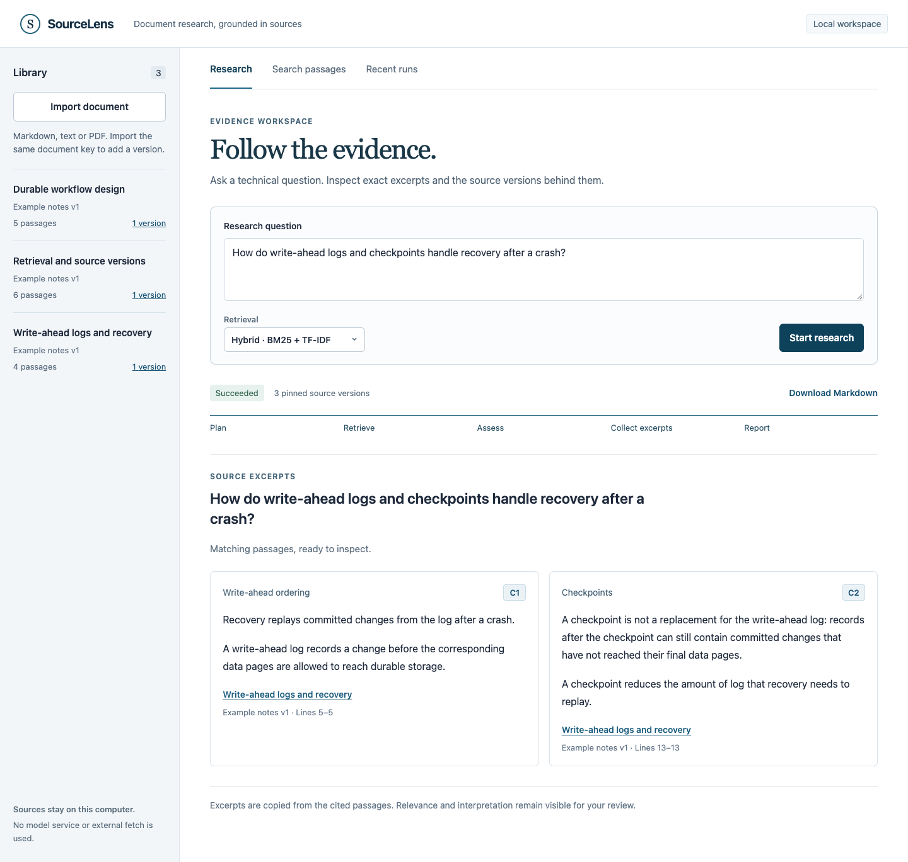

# SourceLens

This is the standalone source-library/research component. The [ArgScope workbench](../README.md) composes its library and API infrastructure with a separate argument-review workflow and provider adapters. Commands below run from this component directory.

A local workspace for researching technical documents with inspectable evidence. Import Markdown, text or PDF, ask a question, compare retrieval methods, and open each excerpt at its original source version.



## Use it

Use a source checkout on macOS or Linux, Python 3.10+ and Node.js 20.19+ or 22.12+. The worker uses a POSIX file lock.

```bash
python -m venv .venv
source .venv/bin/activate
python -m pip install -e '.[test]'
cd web
npm ci
npm run build
cd ..
python -m sourcelens
```

Open **http://127.0.0.1:8765**. Load the example library or import a document. Try:

> How do write-ahead logs and checkpoints handle recovery after a crash?

The application uses no external model service, API key, CDN or automatic web fetch. A source URL is a citation link, not an instruction to download its contents. Imported documents and saved runs live in `var/sourcelens.sqlite3`, which is excluded from Git.

## Research workflow

1. Pin the library's current source versions when the question is submitted.
2. Plan up to three subqueries from explicit subquestions or a marked comparison.
3. Retrieve passages with BM25, character TF-IDF vectors or reciprocal rank fusion.
4. Check for missing lexical evidence and perform at most one follow-up round.
5. Collect exact source excerpts, verify their citations and save a downloadable Markdown report.

The current answer mode is **extractive**. It shows source text rather than generating a paraphrased answer. Character TF-IDF is a lexical vector representation, not a neural semantic embedding. These choices make the first retrieval and citation baseline reproducible without a hosted model.

Every completed workflow node commits state and its progress event in one transaction. On restart, an interrupted run resumes from its next saved stage. Repeated API requests can use an idempotency key; conflicting reuse is rejected.

## Sources and updates

Use the same **document key** when importing a new version. Unchanged content is not indexed twice. Reimporting an old version does not roll the current library back.

New searches use current versions. Existing reports keep their pinned passages and show when a cited source has a newer version. The source drawer exposes the passage, heading, page or line range, version label and content hash.

PDF import supports unencrypted, text-based documents up to 100 pages and 5 MB. Scanned PDFs need OCR before import. The local library is bounded at 100 documents and 4000 stored passages, including historical versions.

The current query tokenizer targets English technical text. Multilingual retrieval and OCR require separate parsing and retrieval evaluation.

## Architecture

```text
React workspace ── FastAPI ── document parser ── SQLite versions + passages + FTS5
                      │                                  │
                      └── persisted job queue             ├── BM25
                               │                         └── TF-IDF vectors
                        LangGraph workflow                       │
                               └── evidence checks ──────────────┘
                                      │
                            cited report + progress events
```

SQLite keeps source updates, jobs and progress checkpoints within one transactional boundary. An in-process worker and loopback binding keep the local operating model simple. PostgreSQL, a distributed queue and multi-user authentication are not required for this release.

The LangGraph workflow is bounded and deterministic; it is not an autonomous LLM agent. A future generative provider can use the same versioned evidence interfaces, but would require separate claim-support and cost evaluation.

## Verify it

```bash
python -m pytest -q
python -m sourcelens.evaluate --output outputs/evaluation.json
```

The evaluation compares the three retrieval methods on the same example corpus and labeled questions. It records Recall@6, MRR@6, no-evidence behavior, quote verification and retrieval latency. The example notes and questions are authored fixtures, not an external benchmark. See [Evaluation](docs/EVALUATION.md) for interpretation.

The browser smoke test exercises research, citation inspection, source updates, search, history, keyboard focus and mobile layout against a running server. Playwright is included in the frontend development dependencies. Install its test browser with `cd web && npm exec playwright install chromium`, then return to the project root and run `node tests/browser_smoke.cjs`. Alternatively, set `SOURCELENS_CHROME` to an existing test-browser executable. Use a disposable database for this test because it adds example sources and a new source version.

For the tested CPython 3.10 core stack, install with `-c requirements-tested.txt`. The frontend's `package-lock.json` records its resolved dependency tree.

## Project map

| Path | Purpose |
| --- | --- |
| `sourcelens/documents.py` | Bounded parsing and source positions |
| `sourcelens/store.py` | Source versions, transactions, jobs and progress events |
| `sourcelens/retrieval.py` | Snapshot-scoped indexes and rank fusion |
| `sourcelens/workflow.py` | Evidence workflow, checkpoints, worker and report contracts |
| `sourcelens/api.py` | Validated HTTP endpoints, upload limits and local-origin controls |
| `web/` | React interface and Vite build |
| `examples/`, `evaluation/` | Authored reference notes and labeled sanity checks |
| `tests/` | Parser, storage, retrieval, workflow, API and browser checks |

[Engineering design](docs/ENGINEERING_DESIGN.md) · [Evaluation](docs/EVALUATION.md)
