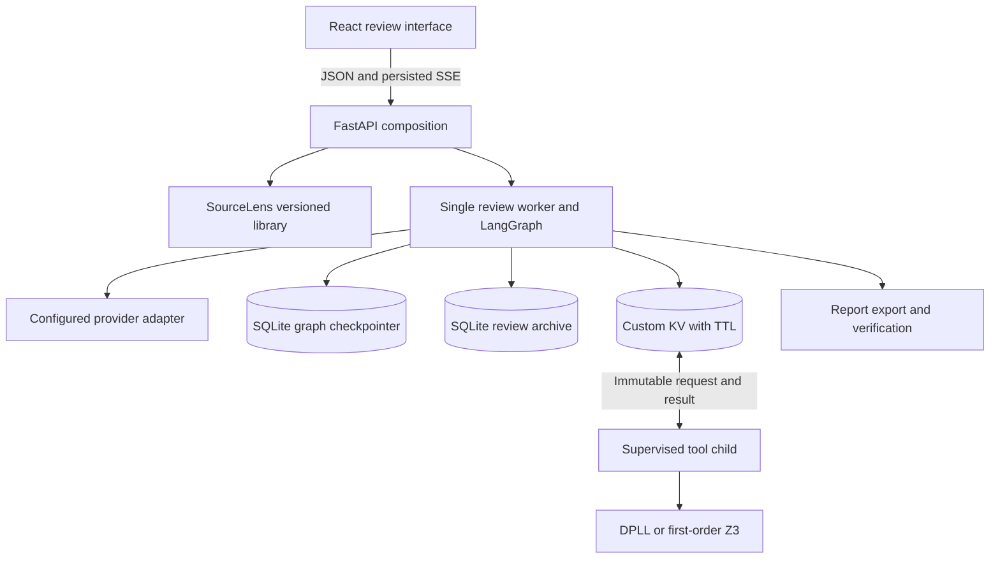
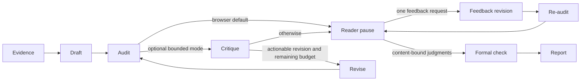

# ArgScope engineering design

ArgScope is a local application for turning a selected argument into a
source-linked, editable reconstruction and checking its declared formal structure.
Its main engineering problem is keeping interpretation, calculation and review
consistent while drafts change, model calls fail, cache entries expire and
processes restart.

The current product is version 0.7.0. The [technical report](FINAL_REPORT.md)
contains worked cases and measured results; [setup and use](MVP_GUIDE.md) covers
installation and operation.

## 1. Requirements and scope

A reader supplies one main passage, a question and optional context. The
application must:

- retain exact source text and distinguish author claims, reported opponents,
  hypothetical reasoning and added assumptions;
- produce a graph the reader can edit before approving a formal mapping;
- check dependencies and supported formulas, including intermediate failures;
- invalidate previews and confirmations when their input changes;
- pause for reader judgment, preserve versions and resume after restart;
- export the same reviewed content and enough formal evidence for local replay.

The service has one review worker and listens on loopback. SourceLens provides a
versioned document library; its broader research interface remains separately
usable. Public multi-user authentication, unrestricted theorem proving, automatic
whole-paper interpretation and global concept-ID editing are outside the current
implementation.

## 2. Architecture and state owners

| Owner | Authoritative state |
| --- | --- |
| LangGraph checkpointer | Execution cursor and committed workflow values |
| Review archive | Frozen requests, drafts, receipts, judgments and events |
| SourceLens | Documents, immutable source versions, chunks and retrieval jobs |
| KV | Expiring tool inputs/results and deterministic memo pointers |
| Tool child | One allowlisted calculation and its result publication |
| Provider | Candidate draft, critique or revision |
| Browser | Unsaved editor content and transient view state |

The graph checkpointer is the only execution cursor. Archive events describe
what happened; they do not implement a competing next-node state machine.
The child process cannot write checkpoints or reader judgments.

FastAPI composes the SourceLens application and argument-review routes. Domain
tools do not import the browser or HTTP layer. Library workers have a separate
lifecycle from the single review executor.

## 3. Reconstruction and input contracts

[schemas.py](../workbench/review/schemas.py) validates the boundary before
workflow execution. A request accepts one main source and up to two contexts,
at most 1,500 main-passage words and 3,000 total source words. Each source has a
unique ID and at most 18,000 characters. A library binding carries document,
version, chunk and upload identities; the API checks those against stored text.

An `argument-draft-v1` record contains one or two readings with at most twenty
nodes each.

| Field | Contract |
| --- | --- |
| Node ID, role and dependencies | Unique IDs, existing references, acyclic dependencies; premises have no incoming dependencies |
| Content, speaker and commitment | Prose claim plus author/opponent/hypothetical/proposed-assumption attribution |
| Source references | Exact quote and Unicode code-point offsets in frozen text |
| Rationale | Reason for an interpretive choice; required for a proposed assumption |
| Target | Existing inference node |
| Formal mapping | Optional node-ID-to-formula mapping and explanation |
| Qualifications | Encoded restrictions or explicit unencoded semantics |

A uniquely occurring exact quote can have its offsets recomputed locally.
The quote's wording is not repaired. Matching text cannot establish that the
quotation supports the proposed interpretation.

Propositional mappings retain their compatible untagged representation.
First-order mappings declare `classical-first-order-v1`. Formula keys are
argument-node IDs, not predicate definitions. Symbol meanings currently live
in the mapping explanation; readers must keep those explanations and formulas
consistent when editing.

## 4. Formal algorithms

### Propositional parsing and search

The [logic component](../../argscope/argscope/logic.py) builds immutable formula
ASTs. [sat.py](../../argscope/argscope/sat.py) introduces Tseitin variables and
clauses for subexpressions, avoiding the expression expansion of distributed CNF.
Bounded, deterministic DPLL applies unit propagation, stops inconsistent branches
and explores remaining assignments.

Returned assignments are projected to original atoms and evaluated on the original
formula ASTs. An entailment query checks premises together with the negated
conclusion. Consistency is reported separately. Dependency analysis checks each
inference from its direct joint premises; a failed or unresolved intermediate
step blocks dependent steps.

Exhaustive enumeration remains a small-instance reference in the component.
The application uses DPLL. Tiny examples solved by propagation do not establish
a measured speed advantage.

### Restricted first-order checking

[first_order.py](../workbench/review/first_order.py) owns its parser, AST,
arity checks, Z3 translation and independent finite-model evaluator. It supports
closed forall/exists formulas, equality, unary/binary predicates and Boolean
connectives over one nonempty classical domain.

Constants, functions, free variables, arithmetic, modal operators and free logic
are not supported. The adapter checks premise consistency before entailment.

| Solver outcome | Application result |
| --- | --- |
| Consistent premises and UNSAT entailment query | Trusted Z3 evidence with backend/version, input digest, resource limits and proof digest/preview |
| SAT with an exported finite interpretation | Countermodel only after independent evaluation of every original AST |
| Inconsistent premises | Separate inconsistency diagnostic |
| Unknown, timeout or no validated finite witness | Unresolved result |

Finite export is limited to eight objects. A smaller subdomain of a larger solver
model is accepted only if the quantified formulas re-evaluate correctly.
Failure to find a small witness is not proof of validity. The UNSAT path has no
independent proof checker.

Each first-order query has a 1,200 ms timeout and 100,000-resource-unit cap.
Parser bounds are 4,000 characters, 600 tokens and bounded nesting, with at most
twelve predicates per check. The enclosing child process has a five-second
deadline. See the [logic guide](FIRST_ORDER_GUIDE.md) for grammar and controls.

## 5. Review workflow and authority

Evidence selection ranks sentences within the supplied passages by question-word
overlap and keeps at most twelve exact spans. Source URLs are metadata, not
instructions to fetch a page.

The browser chooses `single_draft`: generation, deterministic audit, then pause.
The API preserves `bounded_review` when older clients omit the mode.
In bounded mode, critique can propose revision only when an actionable
`revise` issue exists and the revision budget remains.

Draft, critique and revision reuse one configured provider. The model chooses
interpretations and proposed corrections; code owns tools, transitions and limits.
The Codex adapter disables shell and web tools. Model roles are sequential and
do not have independent persistent conversational memories.

Audit supplies structural issues to the optional critic. Full candidate solver
results are shown to the reader, not automatically used to drive another model
repair loop. The paired pilot tests that additional feedback separately.

### Content-bound judgments and edits

The API checks `expected_draft` against the current saved artifact, validates any
edited draft, archives the resulting version, and binds judgments to that content.
The reader supplies fidelity, attribution, interpretation, rationale and explicit
mapping approval. Labels are self-declared; they do not authenticate identity.

`audit_draft_ref` binds the candidate preview. The API suppresses a preview for
a different saved draft; the UI also hides it while unsaved content differs.
Invalid advanced JSON cannot approve an older parsed version.

Under full-reading scope, all three judgments and mapping approval are required
for final checking. A reading can instead declare `formal_scope.mode =
declared_formulas` with a nonblank scope rationale. This path additionally requires
`approve_formula_scope`. Textual judgments may remain disputed; excluded
qualifications remain in the result. Structural validation, prerequisite checks
and resource limits still apply.

New packets bind `review-tools-v3`. Old packets without a tool version replay
with v2, which does not accept formula-only scope. Absent scope fields are omitted
during normalization to preserve legacy content identity.

### Reader feedback and version history

Feedback is separate from approval. A strict feedback request carries the expected
draft, reviewer label, correction and optional edited draft; approval fields are
rejected. Validated edits are saved before the one provider revision. The new
draft receives a deterministic audit and returns to a fresh reader pause.

One feedback attempt is reserved durably before execution. Without a completed
receipt, failure consumes that allowance; retry cannot silently issue another
model call. A receipt completed before failed KV publication can be reused.

Saved versions record origin and parent references. Comparison aligns reading
and node IDs, then reports additions, removals and changed fields. Renamed IDs
appear as additions/removals. No model infers semantic equivalence. Only versions
in the selected run's committed history are comparable; unsaved edits are excluded.
Comparison is read-only, with no rollback, branch merge or reopening of a
completed report.

Final export retains the final draft and version references, not every historical
draft. The archive is necessary to browse the entire comparison history.

## 6. Persistence, receipts and restart

[graph.py](../workbench/review/graph.py) orchestrates a synchronous-durability
SQLite checkpointer and a separate [archive](../workbench/review/store.py).
The human node has no judgment-write side effect before its genuine interrupt.
Restart leaves that pause intact; queued or interrupted non-human work can be
rescheduled.

A model result is validated, archived and assigned a durable operation receipt
before KV publication. Receipt identity includes provider, operation, request,
draft/issues, prompt/workflow revisions and evidence. A publication retry can
therefore reuse completed generation. Generations are not globally memoized
across unrelated runs.

A crash before receipt commit may repeat an external call. Checkpoint, archive
and KV writes are not one distributed transaction. Cancellation is cooperative;
an in-flight operation may complete after a cancellation request.

Provider/live/workflow identities must match to resume an old run. New provider
defaults do not migrate old histories. Saved content remains readable even when
a changed client or prompt makes a run incompatible with resumption.

The API returns at most 100 runs and 200 display events per run. Cancellation
and lifecycle decisions use direct queries rather than that display page, so
an old cancellation cannot disappear behind the event limit.

## 7. KV transport and retention

The parent archives a complete tool request and publishes it with
`SET key value EX seconds NX`. A supervised child receives only the content key,
namespace, loopback endpoint and TTL. It loads the request over RESP/TCP,
executes the allowlisted operation, publishes a linked result, and returns its
key and PID.

The parent verifies digest, artifact kind, input links, operation and tool version
before archiving the result. Memo keys identify deterministic tool inputs.
A pointer whose payload expired is a cache miss; corrupted content is rejected.
The child cannot edit the durable review.

Default TTL is 3,600 seconds, configurable from 1 to 86,400. Records are capped
at 512 KiB. Duplicate JSON keys and nonfinite numbers are rejected. Missing or
incompatible KV stops new work with explicit unavailability; there is no silent
storage-profile substitution. CAS/CAD exist in the server but are not used by
this application path.

SQLite is the durable authority. Archived content can be verified and republished
after TTL expiry. Expiring a transport value does not erase a review or permit
a previously accepted result to bypass input validation.

### Retention and growth

The managed KV runs active expiration every second, reclaiming unread expired
entries from memory. TTL does not shrink the AOF. Manual offline rewrite replays
a stopped session, preserves live values and absolute expiries, verifies a new
log, keeps one protected backup, and replaces the original under a stable
sidecar writer/maintenance lock.

Failure before replacement retains the original. Failure of the final directory
sync reports installed-but-durability-uncertain rather than success. Unix
`fcntl.flock` is required. [Operator commands](MVP_GUIDE.md#offline-aof-maintenance)
explain the stop, preview and apply sequence.

SourceLens retains versions/chunks/indexes with import quotas; review history,
receipts, events and checkpoints remain durable. A run-list limit is not a
storage-retention policy. There is no source-version deletion or run-retirement
interface. Events carry attempt/time accounting and cannot be pruned as ordinary
logs without migrating that authority.

KV is useful here as an explicit process and lifetime boundary. A simpler
single-process application could keep tool exchange in SQLite. Transport adds
serialization, another service and separate failure windows; no matched
performance experiment establishes a speed advantage.

## 8. Interfaces, limits and security

[API_REFERENCE.md](API_REFERENCE.md) specifies the HTTP contract. POSTs require
JSON, reject duplicate keys/nonfinite numbers and limit ordinary review bodies
to 200,000 bytes; packet verification permits 2,000,000 bytes. Host/Origin guards
come from SourceLens. Browser payloads cannot select executable paths, model
URLs, KV endpoints or database locations.

| Limit | Behavior |
| --- | --- |
| Automatic model attempts | Six, including failed attempts |
| Automatic revisions | At most two |
| Reader-requested revision | One additional model attempt |
| Deterministic tools | Twelve attempts |
| Active workflow allowance | 120 s initially, 210 s cumulative after feedback |
| Provider timeout defaults | Bailian 60 s; Codex 90 s; Ollama 30 s |
| Tool child deadline | Five seconds |

Active-time limits exclude human waiting and are checked at node boundaries.
An in-flight call can outlast a boundary budget. Provider configuration and
timeouts are operator settings, not values supplied by source text.

Live adapters implement `generate(operation, request, draft, issues, evidence)`.
A content-versioned, provider-neutral prompt policy is separate from transport.
Case-specific guidance stays in the case request. Adapter identity changes prevent
receipts created under old prompts from being reused as new outputs.

Codex uses supported client authentication without extracting saved tokens.
Bailian uses an explicitly configured official HTTPS endpoint. Ollama accepts
configured loopback HTTP. Failures never automatically switch to another provider
or an authored example.

Reports contain frozen content and trace. HTML escapes text, contains no scripts
and loads no remote assets. JSON normalizes integral floats for browser round-trips.
Packet verification recomputes formal results, checks integrity and validates
structure. It does not authenticate a reviewer or check a live source library.

## 9. Technical decisions and alternatives

| Decision | Alternatives considered | Reason and cost |
| --- | --- | --- |
| Prose-first typed reconstruction | Immediate formulas; unstructured summary | Attribution and added assumptions survive formalization. It requires explicit review fields and cannot automatically settle their semantics. |
| Separate argument DAG and formula AST | Treat graph arrows as individual entailments | Joint premises and operator/quantifier scope are different structures. Each inference checks the declared premise set. |
| Tseitin/DPLL plus independent witness evaluation | Enumerate every assignment; trust a solver status alone | Avoid CNF expansion and prune conflicts while checking the returned assignment against original formulas. Resource limits remain explicit. |
| Restricted first-order adapter | Flatten quantified claims into propositional atoms; implement a general prover | Preserve uniqueness and equality with bounded parser/solver contracts. Z3 UNSAT evidence remains trusted. |
| Official durable workflow | Fixed in-memory chain; custom durable state machine | Reuse persisted branching and interrupts. Application-specific content, receipt and approval invariants still require separate implementation. |
| One provider with explicit optional revision | Automatic multi-agent debate | Control call count and expose the first reading promptly. Same-model critique remains correlated evidence. |
| Immutable artifacts and expected-version checks | Mutable approved flag | Bind review, preview and reuse to exact content. Extra hashes and saved versions require clear lifecycle rules. |
| Archive before KV publication | Publish first; repeat generation on every transport failure | Reuse a completed paid operation after publication failure. Pre-receipt crashes remain uncertain. |
| SQLite archive plus TTL transport | SQLite-only tools; KV-only history | Preserve durable review while exercising process-local transport and expiry. The extra service is not justified by a measured speedup. |
| Source-layout release | Reorganized export with rewritten paths | Keep import roots, native launchers and relative links consistent. Both UIs and pinned KV must be selected and validated together. |

## 10. Design contributions and their evidence

| Failure to prevent | Implementation | Relevant verification |
| --- | --- | --- |
| Old approval survives an edit | Expected draft, immutable archive and preview binding in [graph](../workbench/review/graph.py) and [API](../workbench/review_app.py) | [Review lifecycle tests](../tests/test_review_mvp.py), [feedback/version tests](../tests/test_feedback_versions.py) |
| A quotation is assigned to the wrong speaker | Typed attribution and explicit assumptions in [schemas](../workbench/review/schemas.py) | Schema tests plus the retained live correction in [technical results](FINAL_REPORT.md#6-live-attribution-correction) |
| Finished generation is repeated after publication failure | Input-bound durable receipt before transport | Publication-failure and restart tests in [review tests](../tests/test_review_mvp.py) |
| A stale KV pointer is treated as a result | Digest/version/input validation in [shared transport](../workbench/review/shared.py) | Corruption, expiry and actual child tests |
| Translation error produces a false countermodel | Original-AST evaluator in [FOL adapter](../workbench/review/first_order.py) and [propositional tools](../../falsifylab/falsifylab/search.py) | [FOL tests](../tests/test_first_order.py), six [formula controls](evidence/reference_checks.json) |
| A late HTTP response replaces newer state | Browser watch-generation/request ordering and coherent API status reads | Forced ordering browser test and service-state regressions |
| A release needs files from the development machine | Explicit selection, pinned KV, rebuilt UIs and extracted startup | [Release tests](../tests/test_release.py) and [extracted verifier](../tools/verify_release.py) |

A changed formula in the Quine example exercises several boundaries together:
the preview disappears, the edited artifact receives a new identity, judgments
bind to it, and the old memo cannot satisfy the new query. A two-object
countermodel is evaluated on the edited AST. The calculation still depends on
the reader's choice of formalization.

## 11. Verification, delivery and current limitations

The test layers cover parser/schema contracts, formula controls, actual KV/child
exchange, feedback/version/restart behavior, and browser/API/export flows.
[build_review_mvp.py](../tools/build_review_mvp.py) selects source and public
documentation; [check_release.py](../tools/check_release.py) checks exact member
hashes, links/assets, English text, private paths, pinned KV and version consistency.

[verify_release.py](../tools/verify_release.py) extracts the actual archive,
clears inherited project imports and model-key variables, starts packaged
application/KV processes, drives both interfaces with offline providers, restarts
saved work and replays exported packets. Browser driver dependencies stay in
the development test environment; application code and data come from the archive.

Current software acceptance is reported in [technical results](FINAL_REPORT.md#8-software-acceptance).
Model interpretation and actual reader effort are separate evaluation questions.

The maintained application lives under `workbench.review`; compatible earlier
CLI/prototype code is isolated under `workbench.legacy`. Neither a new framework
name nor an additional test count is an independent product feature.

Global concept IDs, automatic term-sense propagation, independent UNSAT proof
checking, richer logics, dependency-aware source/run deletion and concurrent
authenticated users remain unimplemented. Those changes require new contracts;
they are not implied by the current graph editor or storage integration.
