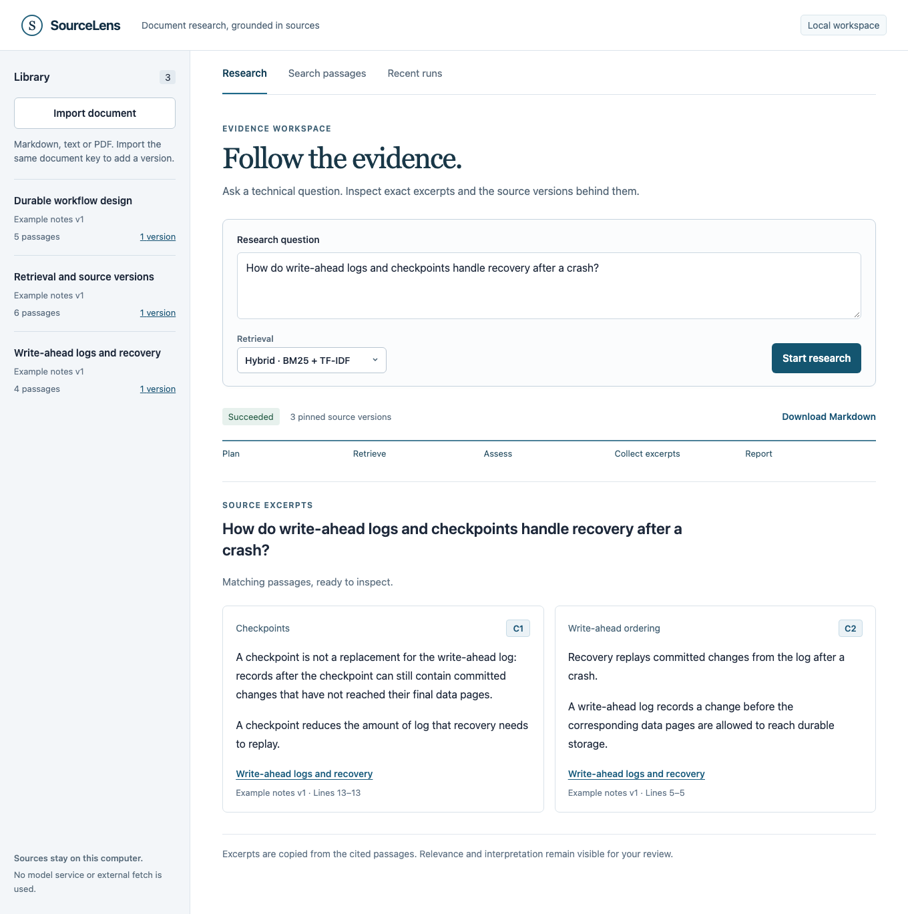

# ArgScope technical report

ArgScope connects source interpretation to executable logic checks in a local
review application. A reader can inspect an attributed reconstruction, edit
formulas and dependencies, compare saved versions, and export the reviewed
argument with its calculation evidence.

The engineering path is implemented and tested. The live-model studies below
are source-bound case observations; independent semantic scoring remains pending.

## 1. Problem and approach

Analytic arguments often distinguish an author's position from a reported
opponent, a temporary supposition, or an unstated bridge. A summary can lose that
distinction while retaining exact quotations. A solver may then correctly check
the formalization of the wrong reading.

The application retains prose nodes, speaker/commitment, exact source spans,
added assumptions, dependencies, formulas, scope and reader judgments together.
It separates three questions:

| Question | Inspectable evidence |
| --- | --- |
| Does this reading fit the passage? | Frozen text, quotations, attribution, assumptions and edits |
| Does this declared conclusion follow? | Dependency checks, supported formulas, solver evidence or an independently evaluated countermodel |
| Why accept the premises? | Explicit premises and recorded rationale; their philosophical or empirical justification remains with the reader |

The unit of work is one selected passage and one question, with up to two context
passages. A small, inspectable reconstruction is more useful here than an
unreviewable whole-paper verdict.

## 2. Complete application workflow

The browser generates one draft, audits references/structure and supported
candidate formulas, then pauses. The reader can select nodes, change formulas
and joint dependencies, add assumptions, or edit the complete validated draft.
Candidate results disappear while their input differs from the editor.

The reader may request one model revision. That action saves the input edits,
records feedback, invokes the configured provider once, re-audits, and pauses
again. It does not approve the new content. Saved versions can be compared by
reading/node ID after restart.

Final checking uses judgments bound to the edited content. A full-reading check
requires accepted fidelity, attribution and interpretation plus mapping approval.
An explicitly declared-formula scope can be checked while interpretation remains
disputed; its exclusions stay in the report and require separate confirmation.



The source library freezes document versions and resolves cited passages.
The illustrated example uses authored notes and no model service. Argument
review can bind a passage to that exact stored version.

## 3. Quine and negative unique descriptions

The Quine example comes from the Russellian description discussion in
*On What There Is*. It distinguishes the denial of exactly one author from the
claim that there is no author. The source record marks two exact phrases joined
by an editorial newline and links the complete paragraph.

Let `W(x)` mean x wrote Waverley:

```text
A = ~(exists x. (W(x) & forall y. (W(y) -> y = x)))

B = (forall x. ~W(x)) |
    (exists x. (W(x) & exists y. (W(y) & ~(x = y))))
```

A denies exactly one W object; B allows zero or at least two. The two directions
A entails B and B entails A return UNSAT for consistent premises plus negated
conclusion under the declared classical first-order semantics.

The denial is a conditional supposition in this task, not a historical assertion
that Waverley lacked a unique author. The local equivalence does not formalize
Quine's broader claims about meaningfulness.

### Countermodel control

Replacing B with `forall x. ~W(x)` loses the multiple-author case:

```text
Domain: {0, 1}
W(0): true
W(1): true
A: true
forall x. ~W(x): false
```

The original-AST evaluator checks every formula against complete finite
predicate tables independently of the Z3 translation. Adding an explicit
at-most-one-W assumption makes the shortcut conditionally valid. The added
premise must remain visible, rather than silently repairing the reading.

This case gives quantified scope and equality a concrete purpose. A propositional
atom standing for the entire sentence would conceal the distinction the reader
is trying to examine.

## 4. Chalmers and a valid local inference

The displayed argument in section 2 of *The Singularity: A Philosophical Analysis*
has this local form:

```text
P1: p
P2: p -> q
C:  q
```

Here p denotes the occurrence of AI+ and q the occurrence of AI++.
Tseitin/DPLL checking finds no assignment satisfying both premises and the
negated conclusion. A deliberately altered control removes P2 and admits
`p=true, q=false`, which is evaluated again on the original AST.

The result concerns the displayed inference. It supplies no independent evidence
that either predictive premise is true. Later time qualifications and defeaters
need their own representation. The retained PDF edition and selected pages are
identified explicitly; a course-copy filename is not used to infer publication date.

Together, Quine and Chalmers exercise different reasoning tasks: quantified
uniqueness and propositional implication. Neither authored example is an
independent model-quality reference judgment.

## 5. Engineering mechanisms

### Representation and calculation

Strict prose records reject duplicate IDs, missing references, cycles, incorrect
quotes and malformed formulas. Added assumptions carry reasons.
The argument DAG records joint dependence; formula ASTs record internal operator
and quantifier scope.

Tseitin encoding avoids distributed-CNF expansion. DPLL propagates forced literals
and prunes conflicts under explicit limits. The first-order adapter separately
checks parser/arity rules, premise consistency and a bounded Z3 query.
Returned assignments and finite models are independently evaluated on original
ASTs. An unresolved prerequisite blocks a dependent step.

A trusted first-order UNSAT result has backend/version, input identity and proof
digest/preview, but no independent proof checker. Failure to materialize a small
finite countermodel remains unresolved.

### State, revision and recovery

The official LangGraph checkpointer owns execution position. A separate SQLite
archive retains immutable content, receipts, judgments and events.
The human interrupt writes no approval before pausing. On restart, a paused
review remains paused.

Expected-draft checks prevent a stale reader submission from changing a newer
version. Preview binding and browser request ordering prevent old calculations
or late HTTP responses from appearing current. Version comparison reads committed
history without changing the editor.

A completed model result and receipt are archived before KV publication.
A publication retry can reuse that result; a crash before receipt commit may
repeat an external call. These stores do not form one distributed transaction.

### Tool exchange

The parent publishes an immutable request to the custom RESP/TCP service.
A supervised child retrieves it, calculates, and publishes an input-linked result.
The parent verifies digest, operation and tool version before retaining it.
Missing expired payloads are cache misses; corrupted payloads are rejected.

SQLite remains the permanent review authority. KV introduces a separate process
and lifetime boundary, not a measured throughput advantage. Active expiration
reclaims memory; offline AOF rewrite preserves live values and absolute deadlines.
The [engineering design](ENGINEERING_DESIGN.md) gives the alternatives, limits,
implementation paths and failure tests for each mechanism.

## 6. Live attribution correction

A guided Quine/McX trial exposed an error that exact quotation checks did not catch:
a model assigned an added intelligibility premise to Quine, and its subsequent
critic accepted the draft.

A specific reader-feedback request caused one revision to change P2 from
`author_position`/Quine to `proposed_assumption`/reconstructor and acknowledge
the textual gap. The formula dictionary stayed identical. Three immutable
versions and a ten-field comparison survived restart.

This is a useful distinction between changing formulas and correcting attribution.
The operator both supplied and assessed the feedback; the revised prose retained
interpretive concerns and no actual human approval was issued.
The [retained observation](evidence/bailian-quine-feedback-20261124.json) identifies
the provider, source snapshot, artifacts and remaining issues.

## 7. Four-passage paired pilot

### Design

The pilot froze four Quine/Chalmers excerpts:

- reported McX reasoning and attribution;
- negative descriptions and uniqueness;
- the basic intelligence-explosion inference;
- a qualified version with timing and defeater assumptions.

For each passage, A1 is one initial draft shared by both follow-up arms.
A2 receives model critique and one revision. A3 uses the same two-extra-call
budget with deterministic structural/formal feedback. The shared initial draft
and matched call allowance separate feedback design from a different first sample
or a larger generation budget.

The runner records source/dependency/prompt identities, corpus and request hashes,
model alias, attempt inputs/outputs, usage, duration and failures.
Scoring must bind to the exact output and an actual reviewer. A model cannot
supply the missing human score.

### Observed results

The recorded pilot used explicit `gpt-6.1-sol`, completed 20 calls and produced
twelve A1/A2/A3 artifacts in 615.893 seconds. Reported usage was 353,537 input
tokens, including 30,208 cached input tokens, and 21,986 output tokens.
The model alias is mutable; no immutable server revision was returned.

| Passage | Observed change | Remaining issue |
| --- | --- | --- |
| McX attribution | A3 adds missing references and labels an inferred bridge as an added assumption | Proposed assumptions increase; this does not establish author intent |
| Negative descriptions | Versions preserve zero-or-multiple authors; A3 adds references and limits the FOL mapping | Meaningfulness and the broader semantic conclusion remain unencoded |
| Basic Singularity inference | Versions retain p, p -> q, q and separate premise support | Premise-support/temporal qualifications still affect the historical gate |
| Qualified Singularity inference | Revisions identify speed/intelligence separation and scenario assumptions | Timing, defeaters and premise justification remain unencoded |

All twelve historical candidate audits returned `unsupported_semantics`.
That does not mean twelve invalid arguments: the historical full-reading gate
blocked any unencoded qualification, including notes outside the local derivation.
The current declared-formula scope is an explicit way to preserve such exclusions
while checking a narrower approved mapping; these old outputs were not rerun or
relabelled under the new contract.

Tool feedback removed deterministic missing-reference warnings, sometimes by
adding a quotation and sometimes by reclassifying a claim as an assumption.
Warning disappearance is not a semantic accuracy measure.
Transcription review, independent ratings, actual reader edits and effort
measurements remain pending.

[Source-bound pilot record](evidence/codex-pilot-20261124.json) and
[study configuration](../studies/pilot-v1.json) retain the experiment's identities.
The executable runner is [run_pilot.py](../tools/run_pilot.py).

## 8. Software acceptance

The four component suites passed 233 regression tests on 26 November 2026.
Extracted-archive acceptance started packaged code and pinned KV, exercised both
interfaces, feedback/versions, actual process restart and four CLI packet replays.
Browser checks recorded no page errors or external requests. Model calls were zero;
review judgments were test fixtures.

| Layer | What it establishes |
| --- | --- |
| Schema/parser tests | Accepted and rejected representation contracts |
| Six formula controls | Declared entailments, altered controls and original-AST witness checks |
| Actual KV/child tests | Request consumption, identity, expiry, corruption and failure handling |
| Review/restart tests | Fresh judgments, receipt reuse, pause and version persistence |
| Browser acceptance | Real UI/API/storage flows, desktop/mobile layout and stale-response handling |
| Live pilot | Recorded behavior of the selected provider on four frozen passages |

The [formula record](evidence/reference_checks.json) can be regenerated without a
model or KV using the command in the [logic guide](FIRST_ORDER_GUIDE.md).
The [setup guide](MVP_GUIDE.md#tests-and-portable-release) describes test, build,
archive-validation and extracted-acceptance commands.

The CI configuration runs offline layers on Ubuntu and macOS. Historical
measurements stay attached to their original source versions; they are not added
to the current test count or presented as current coverage.

## 9. Reproducibility and data handling

A new experiment records a sorted source-file SHA map before and after execution,
dependency and lock identities, selected provider/model, non-secret configuration,
input/corpus hashes, attempt receipts and output/review identities. Concurrent
source changes invalidate scoring. An alias or client binary hash does not
identify immutable model weights.

The runner uses a fresh output directory and preserves rejected returned JSON
and failed attempts. A hard process kill can leave an incomplete record after
a paid request; absence of final output is not evidence of zero cost.
File digests establish byte identity, not reviewer authentication or a signature.

Release checks bind all selected source, documentation, built assets and pinned KV
to one manifest. Acceptance records and final ZIP hashes are stored outside the
sealed archive to avoid a self-reference. Changes produce a new candidate rather
than modifying an old ZIP.

Public examples use published philosophical passages or authored controls.
Runtime source text, credentials, account configuration, databases and raw runs
are not source-distribution inputs.

## 10. Current limits

The implemented application supports a local reader-controlled formal review,
not independently scored autonomous philosophical interpretation.
Concept meanings still need coordinated formula/prose edits; stable global concept
IDs and automatic sense-split propagation remain future work.

The first-order backend has bounded syntax and finite witness export, trusted
Z3 UNSAT evidence and no modal/free-logic support. The service has one review
worker, self-declared reviewer labels and no public multi-user authentication.
KV speed, semantic accuracy and reader-effort improvements have not been measured.

These limits identify separate next questions: the usefulness of the reconstruction
to actual readers, faithful term editing, stronger proof evidence, and the cost of
additional workflow/storage complexity.

## References and further detail

- [Quine teaching transcription](https://rintintin.colorado.edu/~vancecd/phil375/Quine.pdf), negative-description discussion on transcription p.4.
- [Chalmers author version](https://www.consc.net/papers/singularity.pdf), displayed argument in section 2.
- [Formal syntax and controls](FIRST_ORDER_GUIDE.md).
- [Engineering design and technical decisions](ENGINEERING_DESIGN.md).
- [Setup, providers and operations](MVP_GUIDE.md).
- [API contracts](API_REFERENCE.md).
