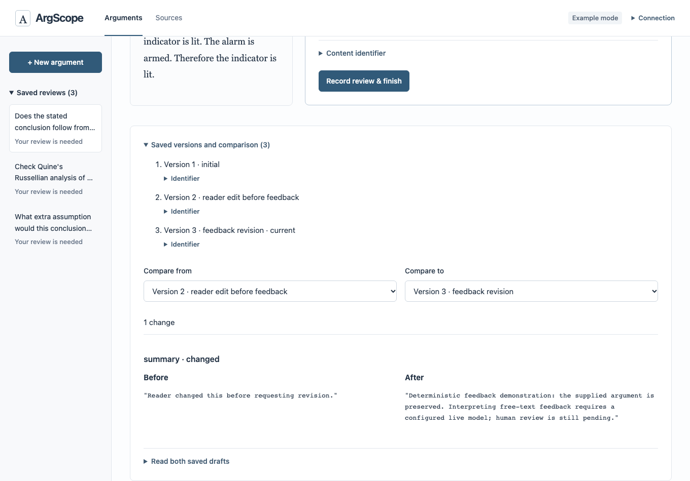

# Set up and use ArgScope

ArgScope 0.7.0 runs locally on macOS or Linux with Python 3.10 or 3.11.
A portable release includes both built interfaces and the pinned KV runtime.
A source checkout additionally needs Node 22 to rebuild the interfaces.

## Installation

Run from the directory containing `workbench/`, `argscope/`,
`falsifylab/`, `sourcelens/` and `vendor/`:

```bash
python3.10 -m venv .venv
.venv/bin/python -m pip install -r workbench/requirements-review.txt
export PYTHONPATH="$PWD/workbench:$PWD/argscope:$PWD/falsifylab:$PWD/sourcelens"
```

For a source checkout:

```bash
npm ci --prefix sourcelens/web
npm run build --prefix sourcelens/web
node sourcelens/web/node_modules/vite/bin/vite.js build \
  --config workbench/review_web/vite.config.mjs
```

Node is needed for building and browser tests, not for ordinary Python startup
once the assets exist. Recreate the virtual environment on another machine;
copying a prepared environment does not make it portable.

## First offline review

```bash
.venv/bin/python -m workbench.review_app \
  --provider papers --kv-root vendor/kv_server \
  --data-dir workbench/outputs/paper-examples-data \
  --port 8767 --open-browser
```

1. The new-review form starts empty. Open “Try an example,” select Quine's
   negative-description example and choose “Use example.”
2. Generate the review. This offline mode supplies an explicitly authored
   reconstruction; the workflow, KV child, logic checks and saved review are real.
3. Select graph nodes and inspect formulas, source quotations and dependencies.
   Incoming edges form one joint premise set.
4. Edit the formulas/dependencies/target in the graph panel, or use validated JSON
   for complete reconstruction changes. Unsaved edits hide stale candidate results.
5. Record your own judgments, label and rationale. Explicitly approve the mapping
   only if you endorse it. No approval is selected by default.
6. Finish, inspect the result and export JSON or script-free HTML.

Use Chalmers next to inspect the displayed `p, p -> q, therefore q` inference.
The [logic guide](FIRST_ORDER_GUIDE.md) explains the valid mappings and deliberately
altered countermodel controls.

For a conditional calculation while interpretation remains disputed, choose
“Check declared formulas only,” explain the scope, and confirm both mapping and
formula-only scope at submission. The result retains excluded qualifications.

Changing a formula does not automatically update its explanation or quotations.
Global term-ID editing and automatic sense-split propagation are not implemented.

## Reader feedback and saved versions

At the pause, “Revise once with my feedback” saves current validated edits as
the revision input, calls the configured provider once, audits the new result,
and returns to reader review. It is separate from “Record review & finish.”
New content clears the old confirmations.

The offline modes demonstrate the lifecycle but do not interpret arbitrary
feedback. Use an explicitly configured live provider for that task.

Open “Saved versions and comparison,” choose two saved versions, and inspect
ID-aligned field changes or complete drafts. The editor remains on the current
version. Unsaved text is excluded until feedback or final submission.
Comparison does not roll back or merge versions.



This offline acceptance example shows the saved draft changing after a requested
revision. The provider and reviewer are test fixtures; the comparison reads actual
persisted versions.

A failed feedback call consumes its one attempt unless a completed operation
receipt is available for reuse after publication failure. Older v1 tasks can
finish their original review but need a new task for feedback.

## Recheck an exported report

```bash
.venv/bin/python -m workbench.review_app verify-report /path/to/argument-review.json
```

The browser also accepts an exported packet for verification. Both paths check
integrity, frozen structure and recomputed formal results. They do not authenticate
the reviewer or contact the live source library. Use compatible solver/tool
versions for replay.

A paused task can be reopened without completing a report. Preserve the local
archive to inspect all historical versions: final export contains the final draft
and version references, not every earlier draft.

## Configure a provider

| Mode | Behavior | Requirement |
| --- | --- | --- |
| `papers` | Authored Quine/Chalmers reconstructions | No model or account |
| `demo` | Five scripted/extractive controls | No model or account |
| `codex` | Official local CLI structured generation | Installed CLI and supported client login/access |
| `bailian` | Configured remote model generation | Operator-supplied credential and enabled HTTPS service/model |
| `ollama` | Configured loopback model generation | Installed model and running local service |

The CLI defaults to Codex; choose `papers` explicitly for an offline run.
A failed provider never silently becomes a demo or switches providers.
Ollama has retained mock-contract coverage, not a completed running-model
quality trial.

### Codex

```bash
codex --version
codex login status
.venv/bin/python -m workbench.review_app \
  --provider codex --kv-root vendor/kv_server \
  --data-dir workbench/outputs/codex-data --port 8768 --open-browser
```

Use `--codex-bin` or `ARGSCOPE_CODEX_BIN` for an explicitly selected executable.
`--model` selects an available client model; otherwise the identity records
`client-default`. Supported client authentication stays with the client.
The application does not extract saved tokens or require a new Platform API key.

### Bailian

Keep the credential file outside public source. Supported settings are
`BAILI_API_KEY` or `DASHSCOPE_API_KEY`, `BAILI_API_URL` and `BAILI_MODEL`.

```bash
.venv/bin/python -m workbench.review_app \
  --provider bailian --model-config /path/to/operator.env \
  --kv-root vendor/kv_server \
  --data-dir workbench/outputs/bailian-data --port 8769
```

Only supported official HTTPS hosts are accepted. The native launcher accepts
`ARGSCOPE_BAILIAN_CONFIG` for another local configuration path.

The historical paper-check CLI makes paid calls only when invoked explicitly:

```bash
.venv/bin/python workbench/tools/validate_paper_workflows.py \
  --config /path/to/operator.env --output /path/to/new-paper-check
```

It requires a new output directory and defaults to the pinned KV.

### Ollama

```bash
.venv/bin/python -m workbench.review_app \
  --provider ollama --model YOUR_INSTALLED_MODEL \
  --model-url http://127.0.0.1:11434 \
  --kv-root vendor/kv_server \
  --data-dir workbench/outputs/ollama-data --port 8770
```

Only a configured loopback endpoint is accepted. The application does not
download a model automatically.

## Native macOS launchers

After setup, `workbench/ArgScope.app`, `ArgScope Codex.app` and
`Launch Codex.command` start Codex on port 8768.
`Launch Paper Examples.command` starts offline papers on 8767.
`Launch MVP.command` defaults to Codex on 8767; `Launch Bailian.command`
selects Bailian.

These are wrappers around the checkout, environment and bundled KV, not installed
self-contained applications. Keep them in `workbench/` or create a Finder alias.
They explicitly open Terminal, wait for matching provider health and reuse a
matching default service on repeated launch. Custom CLI arguments bypass that
convenience check.

Keep Terminal open; Control+C stops the app and its managed KV.
Use different ports and data directories for separate instances.

## KV and application data

`--kv-root vendor/kv_server` starts an isolated instance and owns its AOF.
For an existing compatible loopback service, omit `--kv-root` and supply
`--kv-port PORT`. An external service's lifetime belongs to its operator.

The runtime must support `PING`, `GET`, atomic `SET ... EX ... NX`
and ordinary `SET ... EX`. PING alone does not establish compatibility.
The application does not use the independent KV project's default data file.

| File in the selected data directory | Purpose |
| --- | --- |
| `reviews.sqlite3` | Frozen artifacts, receipts, judgments and events |
| `graph.sqlite3` | Workflow checkpoints |
| `sources.sqlite3` | Source library |
| `sources.sqlite3.worker.lock` | Source worker ownership |
| `shared-session.aof` | Managed KV persistence |

Stop writers before copying the complete data directory for backup. Do not run
two instances against the same directory or delete a live ownership lock.

Restart preserves a reader pause. Queued/interrupted work can resume when its
provider/workflow identity and remaining budget permit. Readable historical
content may not be resumable after a prompt, client or adapter change; start a
new run rather than rewriting its recorded identity.

KV TTL expiry can be recovered from durable artifacts. It does not delete review
history or compact the AOF. Review events carry attempt/time accounting, so they
are not ordinary logs to prune.

## Offline AOF maintenance

Stop the owning application and managed KV, then preview an existing session:

```bash
.venv/bin/python vendor/kv_server/rewrite_aof.py \
  workbench/outputs/paper-examples-data/shared-session.aof
```

After inspecting the preview:

```bash
.venv/bin/python vendor/kv_server/rewrite_aof.py \
  workbench/outputs/paper-examples-data/shared-session.aof --apply
```

The rewrite preserves live values and absolute expiry deadlines. It verifies a
same-directory candidate, keeps one non-overwritten `.rewrite-backup` and
replaces the AOF under a stable `.lock` sidecar. Another apply refuses to
overwrite that backup. Leave the sidecar in place; it coordinates writers and
maintenance.

Corrupt/incomplete input is refused. Failures before replacement retain the
original. A final directory-sync failure reports
`installed_durability_uncertain` with exit 2 after installation. Inspect both
files with the service stopped. Restoring an old backup after later writes would
discard those writes.

The operation needs space for source, candidate and backup. The reported AOF
reduction is not the total disk saving while the backup remains. Automatic
rotation, online rewrite and source/run deletion are not implemented.

## Troubleshooting

| Symptom | Check |
| --- | --- |
| Import or Python-environment failure | Activate the project environment, install requirements and set component import paths |
| `/library` returns 503 | Build the SourceLens interface |
| Address in use | Reuse a matching service or choose another port and data directory |
| SourceLens worker already owns the database | Stop that owner or choose another directory; do not remove its live lock |
| New-run HTTP 503 | Check real KV access and atomic EX/NX compatibility |
| Stale draft review | Reload current content and record judgments for that version |
| Candidate disappears after editing | Expected: its input differs from the editor |
| `review_required` | Check judgments, mapping approval and separate formula-scope confirmation where selected |
| `unsupported_semantics` or resource limit | Inspect the qualification or resource reason; it is not a validity result |
| Model request fails | Inspect the configured provider and retained error; use explicit retry within existing limits |

Native startup output is retained in `workbench/outputs/startup.log`.
Model traces and exported reports can contain source text and user judgments;
treat them according to that content's sensitivity.

## Tests and portable release

After setup:

```bash
export REVIEW_TEST_KV_ROOT="$PWD/vendor/kv_server"
.venv/bin/python -m pytest -q argscope/tests
.venv/bin/python -m pytest -q falsifylab/tests
.venv/bin/python -m pytest -q sourcelens/tests
.venv/bin/python -m pytest -q workbench/tests
.venv/bin/python workbench/tools/check_reference_cases.py
```

The component test suites use pytest; install it in the environment when running
tests. Actual-KV test classes are skipped without `REVIEW_TEST_KV_ROOT`.

Build both interfaces before packaging, and choose an unused output path:

```bash
.venv/bin/python workbench/tools/build_review_mvp.py \
  --output workbench/outputs/releases/ArgScope-0.7.0
.venv/bin/python workbench/tools/check_release.py \
  --root workbench/outputs/releases/ArgScope-0.7.0
```

The ZIP includes source, public docs, both built interfaces and pinned KV.
It excludes environments, credentials, source PDFs, databases, AOFs and raw runs.
Existing releases are not overwritten.

From an extracted release, after installing Python dependencies:

```bash
.venv/bin/python launch.py --provider papers --port 8767 --open-browser
```

`launch.py` supplies package-local import, KV and data paths. The following
acceptance uses the development checkout's Playwright dependencies/browser to
drive the actual extracted application:

```bash
.venv/bin/python workbench/tools/verify_release.py \
  --archive workbench/outputs/releases/ArgScope-0.7.0.zip \
  --output workbench/outputs/NEW-RELEASE-ACCEPTANCE
```

Install Playwright's Chromium or set `WORKBENCH_CHROME` to an existing Chrome
executable. `--python` selects another compatible interpreter. Acceptance uses
authored providers, temporary data and simulated reviewers; it makes no model calls.
The [CI workflow](../../.github/workflows/tests.yml) runs these layers on
Ubuntu/macOS. Package hashes and extracted acceptance records should refer to
the exact same archive.

See the [API reference](API_REFERENCE.md), [logic guide](FIRST_ORDER_GUIDE.md)
and [engineering design](ENGINEERING_DESIGN.md) for detailed contracts.
